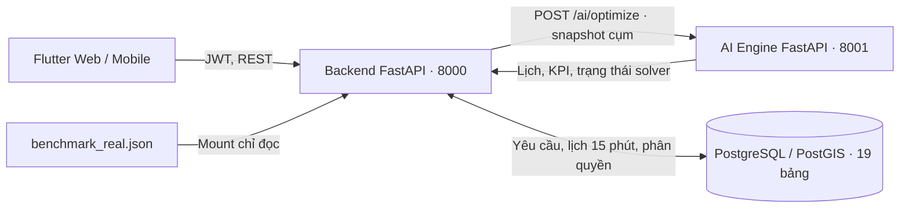

# EV ShareGrid

EV ShareGrid là nguyên mẫu điều phối sạc xe điện tại Đà Nẵng cho Smart Campus 2026 – ISSCEI. Hệ thống xếp lịch sạc theo cửa sổ đỗ xe, công suất cổng, trần công suất cụm và biểu giá.

## Trạng thái tích hợp

| Thành phần | Trạng thái hiện tại |
|---|---|
| Flutter | Đăng nhập, tải xe và trạm, đặt lịch, xem lịch, xác nhận và hủy lịch qua API. Các màn như bản đồ, lịch sử phiên sạc, quản lý cổng của HOST và dự báo của ADMIN vẫn có dữ liệu mô phỏng. |
| Admin Benchmark | Màn ADMIN đọc `GET /api/v1/admin/benchmark`. Trong Compose, backend đọc [báo cáo benchmark](ai_engine/benchmark_real.json) được mount chỉ đọc. |
| Backend FastAPI | JWT và phân quyền USER/HOST/ADMIN. CORS cho `https://ev-sharegrid.web.app` và `http://localhost` với cổng tùy chọn. `POST /api/v1/requests` trả HTTP 422 nếu khung sạc vượt cửa sổ tối ưu 24 giờ và HTTP 409 nếu trùng `idempotency_key`. |
| AI Engine FastAPI | Backend gửi snapshot qua `/ai/optimize`. Solver dùng OR-Tools SCIP cho `MILP_MPC`, GLOP cho `LP_MPC` và LLF khi cần fallback. Bài kiểm chuẩn Trang 20 trả `MILP_MPC / OPTIMAL`, chi phí 5.500 đ, thiếu điện 0 kWh. |
| PostgreSQL/PostGIS | [Schema 19 bảng](database/schema_19_tables.sql). Backend lưu yêu cầu, lần tối ưu và lịch theo slot 15 phút, rồi trả lịch cho Flutter. |



## Chạy nhanh bằng Docker Compose

Cài Docker Engine với Docker Compose plugin và mở terminal ở thư mục gốc của repo. Tạo `.env` từ [file mẫu](.env.example).

```powershell
Copy-Item .env.example .env
```

Trên macOS/Linux, dùng `cp .env.example .env`.

| Biến bắt buộc | Cách cấu hình |
|---|---|
| `POSTGRES_PASSWORD` | Thay chuỗi mẫu bằng mật khẩu riêng cho PostgreSQL local. |
| `JWT_SECRET` | Sinh khóa riêng bằng `python -c "import secrets; print(secrets.token_urlsafe(48))"` và dán giá trị vào `.env`. Backend yêu cầu tối thiểu 32 byte. |
| `AUTH_PASSWORD_HASHES_JSON` | Điền một JSON object ánh xạ email sang hash mật khẩu. Đặt JSON trong dấu nháy đơn ở `.env` để giữ nguyên ký tự `$` của hash. |

Script nạp catalog tạo các tài khoản sau. Mật khẩu do người chạy chọn khi tạo hash.

| Vai trò | Email demo |
|---|---|
| USER | `user1@sharegrid.vn` |
| HOST | `host1@sharegrid.vn` |
| ADMIN | `admin@sharegrid.vn` |

Nếu Python local chưa có thư viện backend, cài bằng `python -m pip install -r backend/requirements.txt`. Lệnh sau hỏi mật khẩu cho ba tài khoản và in ra dòng `AUTH_PASSWORD_HASHES_JSON=...` để dán vào `.env`.

```sh
python -c "import getpass,json; from backend.auth import hash_password; emails=('user1@sharegrid.vn','host1@sharegrid.vn','admin@sharegrid.vn'); hashes={e:hash_password(getpass.getpass(e+' password: ')) for e in emails}; print('AUTH_PASSWORD_HASHES_JSON='+chr(39)+json.dumps(hashes)+chr(39))"
```

```sh
docker compose up --build -d
docker compose ps -a
curl -fsS http://localhost:8001/health
curl -fsS http://localhost:8000/
```

Trong Windows PowerShell có thể gọi `curl.exe`. Khi sẵn sàng, PostgreSQL, AI Engine và backend chạy, còn `catalog-seed` thoát mã 0 sau khi nạp catalog. AI Engine có tài liệu API tại [localhost:8001/docs](http://localhost:8001/docs) và backend tại [localhost:8000/docs](http://localhost:8000/docs). Đăng nhập qua Flutter hoặc `POST /api/v1/auth/login` bằng email seed và mật khẩu đã chọn. File `.env` được Git ignore. Dùng `docker compose down` để dừng.

### Chạy Flutter Web kết nối backend local

```sh
flutter pub get
flutter run -d chrome --dart-define=API_BASE=http://localhost:8000
```

Đăng nhập bằng tài khoản USER để đặt lịch và xem các slot sạc. Đăng nhập bằng ADMIN để xem báo cáo tại `/admin/benchmark`. API đọc lịch trả trạng thái yêu cầu, các slot sạc và, khi đã có kết quả tối ưu, các trường `solver_status`, `algorithm`, `solve_ms` và `explanation`.

## Benchmark thực đo

[Báo cáo sau PR #31](ai_engine/benchmark_real.json) ghi kết quả ngày 19/11/2026 với seed 42, dùng CSV tại commit `b0fc3f7`. Script gọi `POST /ai/benchmark` theo từng cụm với giá cố định 2.000 đ/kWh và **biểu giá TOU giả định theo khung giờ cao/thấp điểm** 1.600/2.400/4.000 đ/kWh. Các hàng dưới đây gộp hai cụm. Đỉnh là tổng công suất cao nhất của hai cụm ở cùng một slot, còn `solve_ms` là tổng thời gian hai lượt đo. Bảng làm tròn để dễ đọc. JSON giữ số đầy đủ.

| Request | Giá | Thuật toán thực chạy | Đúng hạn | Thiếu (kWh) | Chi phí (đ) | Đỉnh (kW) | Vượt trần | solve_ms |
|---:|---|---|---:|---:|---:|---:|---:|---:|
| 100 | TOU | MILP_MPC | 94% | 17,5719 | 7.172.282,48 | 681,0700 | 0 | 15.708,39 |
| 100 | TOU | LLF | 94% | 17,5719 | 7.190.587,84 | 684,0876 | 0 | 10,14 |
| 100 | TOU | ASAP | 94% | 17,5719 | 7.207.205,28 | 773,6312 | 0 | 8,53 |
| 500 | TOU | LLF (cụm 1) + MILP_MPC (cụm 2) | 68,4% | 2.613,4802 | 37.246.807,04 | 850 | 0 | 11.331,22 |
| 500 | TOU | LLF | 68% | 2.614,1306 | 37.302.182,96 | 850 | 0 | 59,23 |
| 1.000 | TOU | LLF | 52,2% | 5.184,4282 | 30.135.059,84 | 850 | 0 | 91,86 |
| 10.000 | Cố định | LLF | 1,74% | 224.282,5779 | 42.161.966,00 | 850 | 0 | 707,04 |
| 10.000 | TOU | LLF | 1,74% | 224.282,5779 | 54.107.690,00 | 850 | 0 | 939,15 |

- **100 request.** Cả hai cụm chạy `MILP_MPC / FEASIBLE`. Với TOU, MILP giảm chi phí **0,2546% so với LLF** và **0,4846% so với ASAP**, trong khi tỷ lệ đúng hạn và điện thiếu bằng nhau ở độ chính xác hiển thị. Với giá cố định, chi phí của ba thuật toán bằng nhau ở độ chính xác hiển thị.
- **500 request.** Cụm 1 có 294 request, vượt ngưỡng 250 nên rơi về LLF (`THRESHOLD_EXCEEDED`). Cụm 2 có 206 request và trả `MILP_MPC / FEASIBLE`. Chỉ xét cụm 2 ở giá TOU, MILP giảm chi phí **0,3952%** so với LLF, cùng đỉnh 350 kW. Với giá cố định, MILP cấp thêm 0,6504 kWh và chi phí tăng 1.300,80 đ so với LLF ở cụm này.
- **Thông lượng.** Báo cáo chỉ đo nhóm thuật toán nhanh ở 1.000 và 10.000 request. Mốc 10.000 mang nhãn `LLF_THROUGHPUT_ONLY`. Đầu vào cần 245.363,5609 kWh trên khả năng cấp 20.400 kWh trong 24 giờ. Số liệu ở mốc này dùng để đọc thông lượng trong điều kiện quá tải.
- **Vượt trần.** Các lượt MILP và LLF trong báo cáo đều ghi 0 lần vượt trần. ASAP ở mốc 500 ghi 53 lần vượt trần trên hai cụm cho mỗi biểu giá. KPI của ASAP cần được đọc cùng điện thiếu và số lần vượt trần.

Từ thư mục gốc, với các thư viện AI Engine đã cài, chạy lệnh sau để tái đo và ghi lại `ai_engine/benchmark_real.json`. Thời gian giải và nghiệm khả thi khi hết ngân sách có thể thay đổi theo máy.

```sh
python -m ai_engine.scripts.benchmark_real --dataset-ref b0fc3f7
```

## Liên hệ chủ đề WEFE (Smart Campus 2026)

Trong trụ cột **Năng lượng xanh và Giao thông thông minh**, lịch sạc là một phụ tải có thể điều phối. Ở mốc 100 request với TOU, đỉnh MILP là **681,0700 kW**, giảm **3,0176 kW (0,4411%)** so với LLF và **92,5612 kW (11,9645%)** so với ASAP. Cả ba đạt 94% đúng hạn trong lượt đo này.

Ở cùng mốc, MILP tiết kiệm **18.305,36 đ** so với LLF với cùng lượng điện cấp ở độ chính xác hiển thị. Kết quả này phù hợp với việc ưu tiên sạc trong các khung giá thấp hơn khi cửa sổ đỗ cho phép. Báo cáo hiện chỉ có KPI tổng hợp, nên chưa xác định được bao nhiêu kWh thực sự chuyển vào khung thấp điểm 1.600 đ/kWh.

Đây là kết quả **mô phỏng các yêu cầu sạc sinh từ catalog trạm và mẫu xe khảo sát dùng cho kịch bản Đà Nẵng**. Giảm đỉnh và dời giờ sạc có thể giảm áp lực lên lưới và tạo dư địa phối hợp với nguồn tái tạo. Benchmark chưa đo công suất phát tái tạo, nhu cầu nâng cấp lưới hay tác động lên nước và thực phẩm.

## Kiểm thử tự động

Kết quả chạy ngày 20/11/2026 trên Windows từ bản code `15c600b`.

| Thành phần | Lệnh tại thư mục gốc | Kết quả |
|---|---|---:|
| AI Engine | `python -m pytest ai_engine/tests -q` | 190 passed |
| Backend | `python -m pytest backend/tests -q` | 52 passed |
| Flutter | `flutter test` | 57 passed |

Cài dependency theo [requirements AI Engine](ai_engine/requirements.txt) và [requirements backend](backend/requirements.txt) trong hai môi trường Python riêng, cùng với `pytest`. Với Flutter, chạy `flutter pub get` trước khi kiểm tra. `dart format --output=none --set-exit-if-changed lib test` kiểm tra 39 file, không đổi file. `flutter analyze` báo `No issues found!`.

## Giới hạn hiện tại và nguồn dữ liệu

- Catalog có **19 mẫu xe và 107 trạm**, trong đó **92 trạm thiếu tọa độ** ở trạng thái `PENDING` và 15 trạm `ACTIVE`. Danh sách cần xác minh nằm trong [stations_missing_coordinates.csv](data/stations_missing_coordinates.csv). Công suất, phân cụm, giờ hoạt động và các trường suy ra được ghi trong ghi chú dữ liệu. `rating` để trống.
- Cửa sổ tối ưu dài **24 giờ**, gồm 96 slot 15 phút tính từ mốc 15 phút ngay trước hoặc bằng thời điểm lập snapshot. Toàn bộ khung sạc phải nằm trong cửa sổ này. Lịch vượt mốc kết thúc nhận HTTP 422 trước bước ghi yêu cầu.
- Nguồn biểu giá trong [script nạp catalog](scripts/import_catalog.py) được ghi là **biểu giá TOU giả định theo khung giờ cao/thấp điểm**. Repo chưa có số và ngày văn bản EVN đã xác minh cho các mức giá này.
- [ev-sharegrid.web.app](https://ev-sharegrid.web.app) là bản Flutter trên Firebase Hosting. Workflow hiện build web với `API_BASE` mặc định `http://localhost:8000`. Nếu chưa có backend HTTPS công khai và bản web chưa được build với URL đó, dùng bản Hosting để xem giao diện và chạy Flutter cùng Compose cục bộ để demo luồng API.
- Một số màn USER, HOST và ADMIN vẫn hiển thị dữ liệu mô phỏng. Các KPI benchmark lấy từ báo cáo JSON của AI Engine.

## Ảnh chụp màn hình

| Màn hình | Ảnh |
|---|---|
| USER – đặt lịch và kết quả | Chưa bổ sung |
| HOST – lịch cổng sạc | Chưa bổ sung |
| ADMIN – benchmark | Chưa bổ sung |

## Checklist nộp Smart Campus 2026

- [x] Có báo cáo benchmark tái lập, ghi rõ thuật toán thực chạy, fallback và phạm vi so sánh.
- [x] Ghi số lượng test đã chạy và cách chạy demo cục bộ.
- [ ] Đối chiếu biểu mẫu, hạn nộp và trường bắt buộc trên cổng ISSCEI.
- [ ] Chuẩn bị slide, ảnh màn hình và video demo dự phòng.
- [ ] Xác minh tọa độ 92 trạm và cập nhật nguồn biểu giá nếu có số, ngày văn bản EVN đã đối chiếu.
- [ ] Xác nhận backend HTTPS công khai và cấu hình `API_BASE` nếu demo qua Firebase Hosting.

## Tài liệu và quy trình

- [CLAUDE.md](CLAUDE.md) mô tả nghiệp vụ và phạm vi hệ thống.
- [AGENTS.md](AGENTS.md) và [git.md](git.md) mô tả cấu trúc repo và quy ước Git.
- [README của AI Engine](ai_engine/README.md) có hướng dẫn chạy riêng và phân tích benchmark theo cụm.
- [Workflow kiểm tra PR](.github/workflows/pr-check.yml) và [workflow Firebase Hosting](.github/workflows/deploy-hosting.yml) mô tả quy trình kiểm tra và triển khai web.
