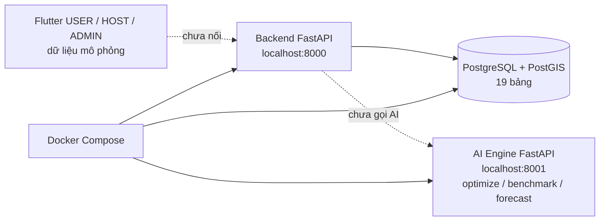

# EV ShareGrid

EV ShareGrid là nguyên mẫu điều phối lịch sạc xe điện cho Đà Nẵng, chuẩn bị tham dự Smart Campus 2026 – ISSCEI. Ứng dụng có ba phân hệ USER, HOST và ADMIN.

## Trạng thái đã kiểm tra

| Thành phần | Trạng thái hiện tại |
|---|---|
| Flutter USER, HOST, ADMIN | Giao diện và dữ liệu mẫu; chưa gọi backend. Các giá trị mô phỏng cần được hiểu theo nhãn trên từng màn. |
| Admin Benchmark | Không còn KPI cứng. Hiện thông báo chưa có artifact benchmark quy mô thực; chưa có `benchmark_real.json`. |
| Backend FastAPI | Có danh mục trạm/mẫu xe và `POST /api/v1/requests`; chưa nối request tới AI Engine, chưa có đăng nhập/phân quyền hoàn chỉnh. |
| AI Engine FastAPI | Chạy độc lập trên cổng 8001; có `/ai/optimize`, `/ai/benchmark`, `/ai/forecast` và `/health`. |
| PostgreSQL/PostGIS | Schema 19 bảng và catalog; cấu hình local nằm trong `.env` không commit. |

Docker Compose khởi động ba dịch vụ, nhưng hiện backend không gọi AI Engine. Vì vậy việc cả ba dịch vụ cùng chạy không đồng nghĩa với luồng đặt lịch Flutter → Backend → AI đã hoàn chỉnh.

## Chạy toàn hệ thống bằng Docker Compose

Cần Docker Engine với Docker Compose plugin. Tạo file cấu hình local rồi thay mật khẩu mẫu bằng giá trị ngẫu nhiên riêng:

```powershell
Copy-Item .env.example .env
```

Hoặc trên macOS/Linux:

```sh
cp .env.example .env
```

Sau khi cập nhật `POSTGRES_PASSWORD` trong `.env`, chạy:

```sh
docker compose up --build
```

Compose khởi tạo PostGIS từ `database/schema_19_tables.sql`, nạp catalog từ các workbook trong `docs/dataofanh/`, rồi khởi động Backend và AI Engine. Địa chỉ local:

| Dịch vụ | Địa chỉ |
|---|---|
| Backend | <http://localhost:8000> |
| AI Engine | <http://localhost:8001> |
| AI health | <http://localhost:8001/health> |
| AI OpenAPI | <http://localhost:8001/docs> |

Dừng stack bằng `docker compose down`; thêm `-v` nếu muốn xóa cả dữ liệu Postgres local. `.env` bị loại khỏi Git; chỉ commit `.env.example`.

## Chạy ứng dụng Flutter

```sh
flutter pub get
flutter run -d chrome
```

Các màn USER/HOST/ADMIN hiện dùng dữ liệu mô phỏng. Chưa có tích hợp đặt lịch Flutter với Backend. Kiểm tra giao diện bằng các đường dẫn:

Các số mẫu UI là fixture cố định trong `lib/data/mock_data.dart`, có nhãn mô phỏng trên khung USER/HOST/ADMIN; chúng không phải đầu ra được sinh bởi benchmark seed 42. Không dùng chúng làm kết quả đo. Để mọi số UI tái sinh theo seed cần nối màn với API/artifact benchmark, việc này chưa hoàn tất.

| Đường dẫn | Màn |
|---|---|
| `/`, `/home`, `/map`, `/station`, `/booking`, `/schedule`, `/sessions`, `/notifications`, `/garage`, `/profile` | USER |
| `/host/stations`, `/host/ports`, `/host/schedule` | HOST |
| `/admin/clusters`, `/admin/review`, `/admin/tariff`, `/admin/solver`, `/admin/benchmark`, `/admin/forecast` | ADMIN |

## Benchmark tái lập

Lệnh dưới đây gọi cùng snapshot `demo` và seed 42 trên bảy thuật toán. Nó trả KPI của ba request tổng hợp trong `ai_engine/data/scenarios/demo.json`; đây không phải dữ liệu vận hành của trường/cụm sạc. `solve_ms` phụ thuộc máy và tải chạy nên sẽ thay đổi giữa các lần đo.

```sh
curl.exe -sS -X POST http://localhost:8001/ai/benchmark -H "Content-Type: application/json" -d '{"scenario_id":"demo","algorithms":["MILP_MPC","LP_MPC","LLF","EDF","FCFS","EQUAL_SHARE","ASAP"],"seed":42,"repeats":1}'
```

Đo ngày 19/11/2026 trên Windows, Python 3.12, một lần chạy, kết quả thực trả về:

| Thuật toán yêu cầu | Thuật toán thực tế | Status | Đúng hạn | Thiếu điện (kWh) | Chi phí (VND) | Đỉnh (kW) | Vượt trần | solve_ms |
|---|---|---:|---:|---:|---:|---:|---:|---:|
| MILP_MPC | MILP_MPC | OPTIMAL | 1.0 | 0.0 | 19000.0 | 13.5 | 0 | 152.15270000044256 |
| LP_MPC | MILP_MPC | OPTIMAL | 1.0 | 0.0 | 19000.0 | 13.5 | 0 | 103.79280000051949 |
| LLF | LLF | FEASIBLE | 1.0 | 0.0 | 19000.0 | 38.0 | 0 | 0.40979999994306127 |
| EDF | EDF | FEASIBLE | 1.0 | 0.0 | 19000.0 | 38.0 | 0 | 0.28790000033040997 |
| FCFS | FCFS | FEASIBLE | 1.0 | 0.0 | 19000.0 | 38.0 | 0 | 0.2687999995032442 |
| EQUAL_SHARE | EQUAL_SHARE | FEASIBLE | 1.0 | 0.0 | 19000.0 | 38.0 | 0 | 0.44160000015835976 |
| ASAP | ASAP | FEASIBLE | 1.0 | 0.0 | 19000.0 | 38.0 | 0 | 0.2733000001171604 |

Kết quả cho biết `LP_MPC` hiện thực tế được báo là `MILP_MPC`; không diễn giải dòng đó như một phép đo LP độc lập. Đây là benchmark demo nhỏ, không thay thế `benchmark_real.json`. Hiện repo chưa có artifact đo cho các mốc 100/500/1.000/10.000 request, nên không công bố các KPI đó.

Có thể tái sinh các CSV kịch bản tổng hợp với seed cố định 42 bằng một lệnh (sau khi catalog, xe và cụm đã có trong `data/`):

```sh
python scripts/generate_100k_data.py --scenarios-only
```

Mỗi request được sinh từ SOC đến, SOC mục tiêu, dung lượng pin và hiệu suất sạc; năng lượng nằm trong dải 15–40 kWh. Generator chỉ ghép xe với trạm có cổng `ACTIVE` cùng đầu nối và dừng nếu tìm thấy sai khớp. Chạy lại benchmark LLF riêng cho bài thông lượng 10.000 request bằng:

```sh
python scripts/measure_llf_throughput.py
```

Các CSV được sinh bằng seed 42. Hiện chỉ cụm 1 (500 kW) và cụm 2 (350 kW) có trạm ACTIVE; tổng khả năng cấp 24 giờ là 20.400 kWh. Số liệu đọc từ các file CSV hiện tại:

| Requests | Nhãn trong CSV | Tổng nhu cầu (kWh) | Tỷ lệ tải 24h | TB/xe (kWh) | Min/xe | Max/xe | Sai đầu nối |
|---:|---|---:|---:|---:|---:|---:|---:|
| 100 | `CAPACITY_LIMITED_SAMPLE` | 2.472,3167 | 12,1192% | 24,7232 | 15,1339 | 39,8866 | 0 |
| 500 | `LOAD_CONTROLLED_QUALITY` | 16.319,9998 | 80,0000% | 32,6400 | 16,5614 | 39,9870 | 0 |
| 1.000 | `LOAD_CONTROLLED_QUALITY` | 16.319,9993 | 80,0000% | 16,3200 | 15,0005 | 18,4094 | 0 |
| 2.500 | `THROUGHPUT_OVERLOAD` | 61.459,9220 | 301,2741% | 24,5840 | 15,0041 | 39,9919 | 0 |
| 5.000 | `THROUGHPUT_OVERLOAD` | 122.688,3395 | 601,4134% | 24,5377 | 15,0013 | 39,9671 | 0 |
| 10.000 | `LLF_THROUGHPUT_ONLY` | 245.363,5609 | 1.202,7626% | 24,5364 | 15,0005 | 39,9884 | 0 |

Mốc 100 không thể đạt tải 60% với 100 request: ngay cả mức trần 40 kWh mỗi xe chỉ tương đương 4.000/20.400 kWh (19,6078%); còn giới hạn pin/SOC của mẫu hiện sinh đạt tối đa 3.477,8 kWh. Các mốc 500 và 1.000 được hiệu chỉnh theo từng xe trong giới hạn pin để mỗi cụm nằm ở 80%. Các mốc 2.500 trở lên là tải quá trần; không dùng để kết luận chất lượng điều phối.

Mốc 10.000 được gắn `LLF_THROUGHPUT_ONLY` trong mọi dòng CSV. Đo thật bằng AI Engine `POST /ai/benchmark`, chỉ chạy LLF với biểu giá cố định 2.000 đ/kWh, trên máy Windows/Python 3.12 ngày 19/11/2026; kết quả lưu tại `data/scenario_10000_llf_measurement.json`:

| Thuật toán | Status | solve_ms | Đúng hạn | Thiếu điện (kWh) | Đỉnh (kW) | Số lần vượt trần |
|---|---|---:|---:|---:|---:|---:|
| LLF | FEASIBLE | 823,9341000007698 | 0,0174 | 224.282,57789999997 | 850,0000000000002 | 0 |

Thời gian giải phụ thuộc máy; AI Engine ghi nhận 0 lần vượt trần trong lịch LLF, trong khi đầu vào yêu cầu 245.363,5609 kWh (1.202,7626% khả năng cấp 24 giờ). Đây là bài test thông lượng LLF, không phải phép đo chất lượng điều phối; tỷ lệ đúng hạn thấp và thiếu điện lớn là hệ quả của tải đầu vào quá mức.

## Đóng góp vào liên kết WEFE (trụ cột Năng lượng xanh và Giao thông thông minh)

ShareGrid hướng tới phối hợp thời điểm sạc xe điện để hạn chế sạc đồng thời vào giờ cao điểm và chuyển một phần nhu cầu sang các khung giá thấp hơn. Nếu triển khai cùng trần công suất cụm, cách điều phối này có thể giúp sử dụng hạ tầng hiện hữu hiệu quả hơn và tạo thêm dư địa tiếp nhận năng lượng tái tạo.

Các tác động trên hiện là **giả thuyết thiết kế**, chưa phải kết quả đo được. Repo không có `benchmark_real.json`; solver chỉ xét trần công suất cố định và biểu giá mô phỏng, không có dữ liệu phát điện tái tạo hoặc mô hình chi phí nâng cấp lưới. Do đó chưa công bố mức cắt đỉnh, điện chuyển giờ, khoản đầu tư tránh được hay lượng năng lượng tái tạo tiếp nhận.

## Chất lượng và nguồn dữ liệu

- Catalog có 107 trạm; 92 trạm thiếu ít nhất một tọa độ. Các trạm này không ở trạng thái `ACTIVE`; không tự gán tọa độ. Danh sách nằm trong `data/stations_missing_coordinates.csv` để người phụ trách dữ liệu đối chiếu.
- Cột `rating` để trống vì chưa có đánh giá khảo sát đáng tin cậy. Các giá trị suy ra/giả định được ghi trong `qa_notes` hoặc `data_note`, gồm `station_power_kw`, phân cụm, trạng thái và giờ hoạt động.
- Connector trong catalog dùng bốn mã `CCS2`, `Type2`, `CHAdeMO`, `AC_HOME`; tên cũ được chuẩn hóa khi nhập. Ghi chú xe giữ lại mã nguồn khi có chuẩn hóa.
- Nguồn của biểu giá được ghi thống nhất là **"biểu giá TOU giả định theo khung giờ cao/thấp điểm"**. Repo không có số và ngày văn bản xác minh, nên các mức giá này không được giới thiệu là biểu giá chính thức của EVN.
- Không commit `.env`. Quét file Git hiện hành không tìm thấy `.env` được track; `.env.example` chỉ chứa giá trị thay thế, không phải thông tin xác thực.

## Ảnh chụp màn hình

Chưa có ảnh chụp màn hình sản phẩm trong repo. Thay các dòng dưới bằng ảnh chụp sau khi chạy demo; không dùng ảnh icon ứng dụng làm ảnh sản phẩm.

| Màn hình | Ảnh |
|---|---|
| USER – đặt lịch/kết quả | Chưa chụp |
| HOST – lịch cổng sạc | Chưa chụp |
| ADMIN – benchmark | Chưa chụp |

## Sơ đồ kiến trúc hiện trạng



## Kiểm tra

```sh
pytest ai_engine/tests -q
pytest backend -q
dart format lib test
flutter analyze
flutter test
docker compose up --build
```

Backend hiện chưa có bộ test pytest riêng; `pytest backend -q` báo không tìm thấy test. Docker Compose cần chạy trên máy có Docker Engine; kết quả thực thi phụ thuộc môi trường.

## Checklist nộp Smart Campus 2026

- [ ] Điền biểu mẫu và gửi hồ sơ trên cổng ISSCEI trước hạn 24/11/2026; kiểm tra lại thể lệ và trường bắt buộc trực tiếp trên cổng.
- [ ] Quay video demo dự phòng, kiểm tra âm thanh, các màn USER/HOST/ADMIN và lưu bản offline.
- [ ] Chụp ảnh màn hình thật và bổ sung vào README.
- [ ] Có dữ liệu benchmark quy mô phù hợp và artifact tái lập trước khi đưa KPI quy mô lớn vào thuyết minh.
- [ ] Người phụ trách dữ liệu xác minh 92 trạm thiếu tọa độ; không tự suy đoán.
- [ ] Nếu nhóm có số và ngày văn bản EVN đã xác minh, cập nhật `source_ref` và rà lại nhãn biểu giá; hiện nguồn dữ liệu được ghi là giả định.
- [ ] Mô tả rõ giới hạn hiện tại: Flutter chưa nối Backend; Backend chưa gọi AI; chưa có kết quả tác động WEFE đo thực tế.

Thông báo Smart Campus 2026 của [Trung tâm Đổi mới sáng tạo NTU](https://trungtamdmst.ntu.edu.vn/thong-bao/thong-bao-cuoc-thi-smart-campus-2026) nêu lĩnh vực Năng lượng xanh và Giao thông thông minh cùng hạn gửi hồ sơ 24/11/2026.

## Tài liệu và quy trình

- `CLAUDE.md` – nghiệp vụ và phạm vi hệ thống.
- `AGENTS.md`, `git.md` – cấu trúc code, quy ước nhánh/commit và quy trình Git.
- `ai_engine/README.md` – chạy riêng AI Engine.
- `.github/workflows/pr-check.yml` – kiểm tra PR.
