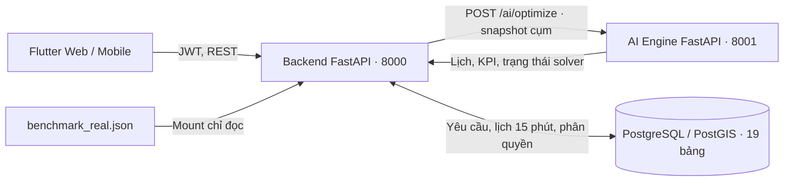

# EV ShareGrid

EV ShareGrid là nguyên mẫu điều phối sạc xe điện tại Đà Nẵng cho Smart Campus 2026 – ISSCEI. Hệ thống xếp lịch sạc theo cửa sổ đỗ xe, công suất cổng, trần công suất cụm và biểu giá.

Trong chủ đề WEFE, dự án tập trung vào năng lượng và giao thông thông minh. Việc điều phối giờ sạc giúp đánh giá khả năng giảm đỉnh tải và tận dụng khung giờ giá thấp hơn trên hạ tầng hiện có.

## Trạng thái tích hợp

| Thành phần | Trạng thái hiện tại |
|---|---|
| Flutter | Đăng nhập, tải xe và trạm, đặt lịch, xem lịch, xác nhận và hủy lịch qua API. Các màn như bản đồ, lịch sử phiên sạc, quản lý cổng của HOST và dự báo của ADMIN vẫn có dữ liệu mô phỏng. |
| Admin Benchmark | Màn ADMIN đọc `GET /api/v1/admin/benchmark`. Trong Compose, backend đọc [báo cáo benchmark](ai_engine/benchmark_real.json) được mount chỉ đọc. |
| Backend FastAPI | JWT và phân quyền USER/HOST/ADMIN. CORS mặc định cho hai domain Firebase của dự án, localhost và 127.0.0.1. Dùng `CORS_ORIGINS` cho domain riêng và `CORS_ORIGIN_REGEX` cho mẫu origin bổ sung. `POST /api/v1/requests` trả HTTP 422 nếu khung sạc vượt cửa sổ tối ưu 24 giờ và HTTP 409 nếu trùng `idempotency_key`. |
| AI Engine FastAPI | Backend gửi snapshot qua `/ai/optimize`. Solver dùng OR-Tools SCIP cho biến nguyên, GLOP cho bài toán đủ điều kiện tuyến tính và LLF khi cần fallback. [Ca kiểm chuẩn Trang 20](ai_engine/samples/page20_input.json) trả `MILP_MPC / OPTIMAL`, chi phí 5.500 đ, thiếu điện 0 kWh. |
| PostgreSQL/PostGIS | [Schema 19 bảng](database/schema_19_tables.sql). Backend lưu yêu cầu, lần tối ưu và lịch theo slot 15 phút, rồi trả lịch cho Flutter. |

Khi worker tối ưu hết hạn, AI Engine dừng worker nếu còn chạy và thử LLF trong tiến trình phục vụ API. Nếu lịch qua kiểm tra, API trả `FALLBACK` kèm `TIME_BUDGET_EXHAUSTED`. Trường hợp này chỉ trả `ERROR` nếu LLF thất bại hoặc lịch không qua kiểm tra. [Hành vi của AI Engine](ai_engine/README.md#gọi-api-bằng-curl-bash)



## Deployment

### A. Ubuntu + Nginx + Cloudflare Quick Tunnel

Trên server mới, từ thư mục gốc repo:

```sh
cp .env.example .env
# Điền POSTGRES_PASSWORD, JWT_SECRET và AUTH_PASSWORD_HASHES_JSON theo .env.example.
./scripts/check-env.sh
docker compose up -d --build
docker compose ps -a
```

File `ai_engine/benchmark_real.json` đã có trong Git và được backend mount chỉ đọc. Với server đã cấu hình, giữ `.env` hiện tại. Mở `http://localhost` và chạy trên cùng máy Ubuntu (đã cài `cloudflared`):

```sh
cloudflared tunnel --url http://127.0.0.1:80
```

Mở URL HTTPS mà tunnel in ra. Để trống `API_BASE_URL` khi build để trình duyệt gọi `/api/v1/...` cùng origin. Nginx phục vụ Flutter và chuyển nguyên đường dẫn API tới FastAPI. Cổng 8000, 8001 và 5432 chỉ bind vào loopback cho công cụ local.

### B. Firebase Hosting + API_BASE_URL

Triển khai backend qua một origin HTTPS mà trình duyệt truy cập được. Trong GitHub Settings → Secrets and variables → Actions, đặt hai repository variables `FIREBASE_PROJECT_ID` và `API_BASE_URL` (chỉ origin, không thêm `/api`), cùng repository secret `FIREBASE_SERVICE_ACCOUNT`. Hosting site trong `firebase.json` phải thuộc project này. Push vào `main` hoặc chạy workflow **Deploy Firebase Hosting** thủ công. Nếu URL backend thay đổi, build và deploy lại. Để deploy thủ công:

```sh
flutter pub get
flutter build web --release --dart-define="API_BASE_URL=$API_BASE_URL"
firebase deploy --only hosting --project "$FIREBASE_PROJECT_ID"
```

Đặt hai biến trong shell trước khi chạy. Firebase rewrite các đường dẫn giao diện về `index.html`; các request API đi trực tiếp đến origin HTTPS đã cấu hình.

## Chạy demo cục bộ bằng Docker Compose

Bản chấm chạy **cục bộ trên Windows** với Docker Desktop, Flutter, Chrome và file `.env`. Nginx và Firebase không cần cho bản demo này.

Nếu Python local chưa có [thư viện backend](backend/requirements.txt), cài bằng `python -m pip install -r backend/requirements.txt`. Mở terminal tại thư mục gốc rồi chạy [script tạo môi trường](scripts/make_demo_env.py):

```sh
python scripts/make_demo_env.py
```

Script sinh cấu hình PostgreSQL và JWT, hỏi mật khẩu ẩn rồi ghi hash vào `.env`. Dùng `--generate-passwords` nếu muốn script sinh và in mật khẩu demo một lần. Git bỏ qua `.env`. Giữ `.env` đã dùng để khởi tạo volume PostgreSQL hiện có vì tạo mật khẩu mới trong file không đổi mật khẩu của DB.

Script nạp catalog tạo các tài khoản sau. Dùng mật khẩu đã chọn hoặc do script tạo lúc chuẩn bị `.env`.

| Vai trò | Email demo |
|---|---|
| USER | `user1@sharegrid.vn` |
| HOST | `host1@sharegrid.vn` |
| ADMIN | `admin@sharegrid.vn` |

Nút demo chỉ điền email. Nhập mật khẩu bằng tay trên màn đăng nhập. Trình duyệt khôi phục JWT và xác thực lại qua `/api/v1/auth/me` khi tải lại trang. Đăng xuất hoặc HTTP 401 sẽ xóa phiên đã lưu.

- Chạy `.\scripts\demo.ps1` trong PowerShell và mở [http://localhost:7357](http://localhost:7357) khi Flutter sẵn sàng.
- Script chờ PostgreSQL, AI Engine và backend healthy, kiểm tra catalog nạp xong, rồi lấy cổng backend từ Compose.
- Nếu đã build image, dùng `.\scripts\demo.ps1 -SkipBuild`. Nếu cổng Flutter đang bận, dùng `.\scripts\demo.ps1 -Port 7358`.
- Sau `git pull` hoặc khi đổi nhánh, chạy `.\scripts\demo.ps1` để Compose build lại image. Image backend cũ có thể thiếu `/api/v1/requests/me` và làm các màn lịch sạc báo 404.
- Để dừng, nhấn `q` trong terminal Flutter và chạy `.\scripts\demo-stop.ps1`. Dữ liệu PostgreSQL được giữ nguyên.

### Cập nhật xác thực trên volume PostgreSQL cũ

Chạy migration [001_app_user_password_hash.sql](database/migrations/001_app_user_password_hash.sql) trước khi mở đăng ký trên DB đã có. Lệnh dưới dùng tên DB mặc định, đổi `-U` và `-d` nếu đã cấu hình tên khác.

```sh
docker compose up -d postgres
docker compose exec -T postgres psql -U postgres -d ev_sharegrid -v ON_ERROR_STOP=1 < database/migrations/001_app_user_password_hash.sql
```

Trong PowerShell, có thể dùng `Get-Content -Raw database/migrations/001_app_user_password_hash.sql | docker compose exec -T postgres psql -U postgres -d ev_sharegrid -v ON_ERROR_STOP=1` cho lệnh áp migration.

### Cập nhật biểu giá trên volume PostgreSQL cũ

Schema mới được nạp tự động khi tạo DB trống. Với volume đã có dữ liệu, chạy đoạn SQL sau trong DB `ev_sharegrid` trước khi seed lại.

```sql
BEGIN;
ALTER TABLE tariff_window
  DROP CONSTRAINT IF EXISTS tariff_window_day_type_check,
  ADD CONSTRAINT tariff_window_day_type_check
    CHECK (day_type IN ('WEEKDAY', 'WEEKEND', 'HOLIDAY', 'MON_SAT', 'SUNDAY'));
COMMIT;
```

Sau đó dùng hai lệnh dưới đây nếu chỉ muốn nạp biểu giá. Các khung cũ được giữ làm lịch sử và phục vụ fallback. Để hoàn tác trên DB đã có lịch sử, gỡ các dòng `MON_SAT` và `SUNDAY` của cụm demo 1–4 có `valid_from = '2026-11-01'` và `source_ref` đúng giá trị trong [script seed](scripts/import_catalog.py).

```sh
docker compose build catalog-seed
docker compose run --rm --no-deps catalog-seed python scripts/import_catalog.py --tariffs-only
```

Đăng nhập bằng tài khoản USER để đặt lịch và xem các slot sạc. Đăng nhập bằng ADMIN để xem báo cáo tại `/admin/benchmark`. API đọc lịch trả trạng thái yêu cầu, các slot sạc và, khi đã có kết quả tối ưu, các trường `solver_status`, `algorithm`, `solve_ms` và `explanation`.

## Benchmark thực đo

[Báo cáo benchmark](ai_engine/benchmark_real.json) ghi kết quả bản sạc liền mạch với seed 42, dùng CSV tại commit `14cec6f`. Script gọi `POST /ai/benchmark` theo từng cụm với giá cố định 2.000 đ/kWh và TOU EVN hạ áp **1.620 / 2.700 / 4.212 đ/kWh** trước VAT. Đây là các kịch bản mô phỏng nhu cầu sạc. Bảng gộp hai cụm, tính đỉnh từ tổng tải theo slot và cộng `solve_ms` của hai lượt đo. Gián đoạn là số lần một yêu cầu bật lại sau khi đã ngừng sạc.

| Request | Giá | Thuật toán thực chạy | Đúng hạn | Thiếu (kWh) | Chi phí (đ) | Đỉnh (kW) | Vượt trần | Gián đoạn | solve_ms |
|---:|---|---|---:|---:|---:|---:|---:|---:|---:|
| 100 | TOU EVN | MILP_MPC | 94% | 17,5719 | 8.276.432,26 | 681,0700 | 0 | 0 | 16.278,36 |
| 100 | TOU EVN | LLF | 94% | 17,5719 | 8.276.432,26 | 684,0876 | 0 | 0 | 37,07 |
| 100 | TOU EVN | ASAP | 94% | 17,5719 | 8.276.432,26 | 773,6312 | 0 | 0 | 17,04 |
| 500 | TOU EVN | LLF + MILP_MPC | 72% | 2.549,0329 | 42.256.368,57 | 850,0000 | 0 | 0 | 10.886,23 |
| 500 | TOU EVN | LLF | 73% | 2.549,4269 | 42.306.055,65 | 850,0000 | 0 | 0 | 88,40 |
| 500 | TOU EVN | ASAP | 67% | 4.777,7031 | 36.338.044,38 | 2.220,0000 | 53 | 0 | 86,86 |
| 1.000 | TOU EVN | LLF | 58,6% | 5.187,7256 | 34.125.737,89 | 850,0000 | 0 | 0 | 161,47 |
| 10.000 | Cố định | LLF | 1,59% | 222.733,0836 | 45.260.954,60 | 850,0000 | 0 | 0 | 1.844,59 |
| 10.000 | TOU EVN | LLF | 1,59% | 222.733,0836 | 62.528.486,17 | 850,0000 | 0 | 0 | 1.867,07 |

- **100 request.** Cả hai cụm dùng `MILP_MPC / FEASIBLE`. MILP, LLF và ASAP có cùng chi phí TOU, tỷ lệ đúng hạn và điện thiếu ở độ chính xác hiển thị. Đỉnh MILP thấp hơn LLF **3,0176 kW** và thấp hơn ASAP **92,5612 kW**.
- **500 request.** Cụm 1 có 294 request, vượt ngưỡng 250 nên dùng LLF (`THRESHOLD_EXCEEDED`). Cụm 2 có 206 request và trả `MILP_MPC / FEASIBLE`. Phương án gộp có chi phí TOU cao hơn ASAP **16,29%**, đồng thời giảm điện thiếu **2.228,6702 kWh** và tránh **53** lần vượt trần.
- **Thông lượng.** Mốc 1.000 và 10.000 chỉ đo nhóm thuật toán nhanh. Mốc 10.000 mang nhãn `LLF_THROUGHPUT_ONLY`. Đầu vào cần 245.363,5609 kWh trên khả năng cấp 20.400 kWh trong 24 giờ.

Chạy lệnh dưới đây từ thư mục gốc để tái đo với cùng dữ liệu. Thời gian giải và nghiệm khả thi khi hết ngân sách có thể thay đổi theo máy.

```sh
python -m ai_engine.scripts.benchmark_real --dataset-ref 14cec6f
```

## Liên hệ chủ đề WEFE (Smart Campus 2026)

Trong trụ cột **Năng lượng xanh và Giao thông thông minh**, lịch sạc là một phụ tải có thể điều phối. Bảng dùng TOU EVN hạ áp và chỉ so sánh các cụm thực sự chạy `MILP_MPC`. `FCFS` là baseline phục vụ theo thứ tự đến (FIFO).

| Phạm vi | Baseline | Chi phí baseline → MILP (đ) | Giảm chi phí | Đỉnh baseline → MILP (kW) | Giảm đỉnh (kW) |
|---|---|---:|---:|---:|---:|
| 100, cả hai cụm | LLF | 8.276.432,26 → 8.276.432,26 | 0,0000% | 684,0876 → 681,0700 | 3,0176 |
| 100, cả hai cụm | FCFS | 8.276.432,26 → 8.276.432,26 | 0,0000% | 773,6312 → 681,0700 | 92,5612 |
| 500, chỉ cụm 2 | LLF | 16.264.879,65 → 16.215.192,57 | 0,3055% | 350,0000 → 350,0000 | 0,0000 |
| 500, chỉ cụm 2 | FCFS | 14.751.475,22 → 16.215.192,57 | -9,9225% | 350,0000 → 350,0000 | 0,0000 |

Chi phí và đỉnh lấy từ [benchmark_real.json](ai_engine/benchmark_real.json). Mức giảm là `(baseline − MILP) / baseline × 100%` cho chi phí và `đỉnh baseline − đỉnh MILP` cho công suất.

Ở mốc 500, so với FCFS tại cụm 2, MILP giảm điện thiếu **604,6476 kWh** và tăng chi phí tổng **1.463.717,35 đ**.

Đây là kết quả **mô phỏng các yêu cầu sạc sinh từ catalog trạm và mẫu xe khảo sát dùng cho kịch bản Đà Nẵng**. Giảm đỉnh và dời giờ sạc có thể giảm áp lực lên lưới và tạo dư địa phối hợp với nguồn tái tạo. Chưa có dữ liệu phát điện theo giờ hoặc hệ số phát thải xác minh cho kịch bản, nên chưa quy đổi sang CO₂ hay lượng năng lượng tái tạo sử dụng.

## Kiểm thử tự động

Kết quả chạy ngày 20/11/2026 trên Windows với mã nguồn bản demo local.

| Thành phần | Lệnh tại thư mục gốc | Kết quả |
|---|---|---:|
| AI Engine | `python -m pytest ai_engine/tests -q` | 208 đạt |
| Backend | `python -m pytest backend/tests -q` | 58 đạt |
| Flutter | `flutter test` | 59 đạt |

Cài dependency theo [requirements AI Engine](ai_engine/requirements.txt) và [requirements backend](backend/requirements.txt) trong hai môi trường Python riêng, cùng với `pytest`. Với Flutter, chạy `flutter pub get` trước khi kiểm tra. `dart format --output=none --set-exit-if-changed lib test` kiểm tra 39 file, không đổi file. `flutter analyze` báo `No issues found!`.

## Giới hạn đã biết và nguồn dữ liệu

- Catalog có **19 mẫu xe và 107/107 trạm có tọa độ tham khảo**. Dữ liệu demo giữ **15 trạm `ACTIVE`** và **92 trạm `PENDING` có `verified=False`**. Xem [catalog trạm](data/charging_station_cleaned.csv). Công suất, phân cụm, giờ hoạt động và các trường suy ra được ghi trong ghi chú dữ liệu. `rating` để trống.
- Tọa độ tham khảo chưa được xác minh thực địa. Cột `qa_notes` trong Excel vẫn giữ ghi chú cũ về tọa độ thiếu và có thể khác dữ liệu hiện tại.
- Cửa sổ tối ưu dài **24 giờ**, gồm 96 slot 15 phút tính từ mốc 15 phút ngay trước hoặc bằng thời điểm lập snapshot. Toàn bộ khung sạc phải nằm trong cửa sổ này. Lịch vượt mốc kết thúc nhận HTTP 422 trước bước ghi yêu cầu.
- Cụm demo **1–4** dùng giả định hạ áp `UP_TO_1KV`. Giá trước VAT từ 01/11/2026 là **1.620 / 2.700 / 4.212 đ/kWh** theo thứ tự thấp điểm, bình thường và cao điểm. Theo giờ Việt Nam, thấp điểm là 00:00–06:00 mỗi ngày. `MON_SAT` (thứ Hai đến thứ Bảy) có cao điểm từ 17:30 đến 22:30, các giờ còn lại là bình thường. `SUNDAY` (Chủ nhật) dùng giá bình thường từ 06:00 đến 24:00. Backend dùng `WEEKDAY` hoặc `WEEKEND` khi thiếu biểu giá EVN có hiệu lực cho ngày cần tính. Cấp điện áp và hợp đồng tại điểm đo cần được xác minh trước khi áp dụng ngoài demo. [Biểu giá đã nạp](data/tariff_window_cleaned.csv) · [Khung giờ của EVN](https://evn.com.vn/d/vi-VN/news/Ap-dung-bieu-gia-ban-le-dien-rieng-cho-sac-xe-dien-60-3557-510231)
- AI Engine mặc định dùng `HOURLY_MEAN` cho cụm có dưới 336 giờ quan sát (14 ngày) hoặc chưa có mô hình đã huấn luyện phù hợp.
- Một số màn USER, HOST và ADMIN vẫn hiển thị dữ liệu mô phỏng. Các KPI benchmark lấy từ báo cáo JSON của AI Engine.

## Ảnh chụp màn hình

| Màn hình | Ảnh |
|---|---|
| Đăng nhập | Chờ bổ sung |
| Bản đồ trạm sạc | Chờ bổ sung |
| Đặt lịch bằng AI | Chờ bổ sung |
| Admin Benchmark | Chờ bổ sung |

**Video demo** — TODO(demo) thêm URL video sau khi quay.

## Checklist nộp Smart Campus 2026

- [x] Có báo cáo benchmark tái lập, ghi rõ thuật toán thực chạy, fallback và phạm vi so sánh.
- [x] Ghi số lượng test đã chạy và cách chạy demo cục bộ.
- [ ] Đối chiếu biểu mẫu, hạn nộp và trường bắt buộc trên cổng ISSCEI.
- [ ] Chuẩn bị slide, ảnh màn hình và video demo dự phòng.
- [ ] Đối chiếu tọa độ tham khảo ngoài thực địa.

## Tài liệu và quy trình

- [CLAUDE.md](CLAUDE.md) mô tả nghiệp vụ và phạm vi hệ thống.
- [AGENTS.md](AGENTS.md) và [git.md](git.md) mô tả cấu trúc repo và quy ước Git.
- [README của AI Engine](ai_engine/README.md) có hướng dẫn chạy riêng và phân tích benchmark theo cụm.
- [Workflow kiểm tra PR](.github/workflows/pr-check.yml) mô tả các bước kiểm tra tự động.
